# Heritage Portal — End-to-End Module Flowcharts

**Live portal:** https://appslure.app  
**Login:** https://appslure.app/login  
**Audience:** Owner, Administrator, Registrar, Instructor, Student and Applicant  
**Purpose:** Follow the modules in dependency order and confirm that the same test record moves successfully from one role to the next.

> A student account can log in without a program. A course or program assignment is required only to make learning content appear in **My Courses**.

---

## 1. Complete Portal Flow — Correct Order

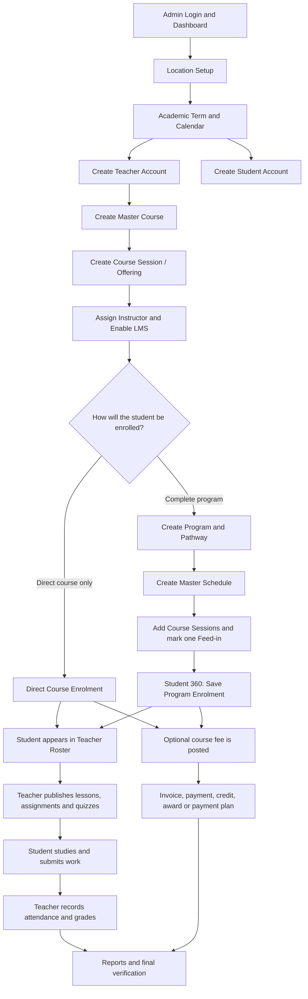

### Mandatory dependency rule

`Location/Term → Teacher + Student → Course → Session → Instructor → Student enrolment → Content → Submission → Grade/Attendance → Finance → Reporting`

Do not test Reporting before real records have been created in the source modules.

---

## 2. Admin Login and Dashboard

**Links**

- Login: https://appslure.app/login
- Dashboard: https://appslure.app/admin

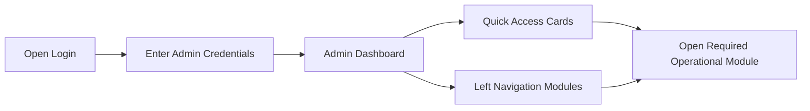

**Verify:** Dashboard loads, role is Admin/Registrar, and the required navigation modules are visible.

---

## 3. User Management — Create Teacher

**Recommended creation link:** https://appslure.app/admin/users/create?role=instructor  
**User directory:** https://appslure.app/admin/user-management

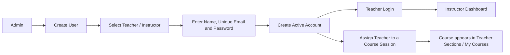

**Important:** Creating a teacher login does not automatically assign a course. The teacher must be selected as the **Instructor** on a course session/offering.

**Program Faculty is not the teacher list.** In Program Settings, **Program Faculty** comes from academic faculty records such as Business or Computer Science. Teachers are selected later in Course Sessions or Master Scheduling.

---

## 4. User Management — Create Student

**Recommended creation link:** https://appslure.app/admin/users/create?role=student  
**Detailed creation:** https://appslure.app/admin/student-management/create  
**Browse students:** https://appslure.app/admin/student-management/browse

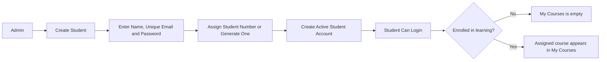

**Rules**

- Program assignment is not required for login.
- An active account with the `student` role can log in immediately.
- A direct course enrolment or program enrolment is required for the course to appear in **My Courses**.
- Student status controls the Student Management sidebar queue. For example, a student with status **Graduated** does not appear in **Approved Application**.

---

## 5. Location Management

Create only missing records and reuse existing records to avoid duplicates.

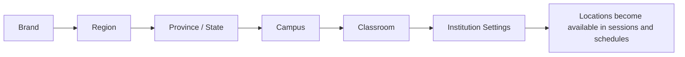

**Links**

- Brands: https://appslure.app/admin/location/brands
- Regions: https://appslure.app/admin/location/regions
- Provinces: https://appslure.app/admin/location/provinces
- Campuses: https://appslure.app/admin/location/campuses
- Classrooms: https://appslure.app/admin/location/classrooms
- Institutions: https://appslure.app/admin/location/institutions

---

## 6. Term and Academic Calendar

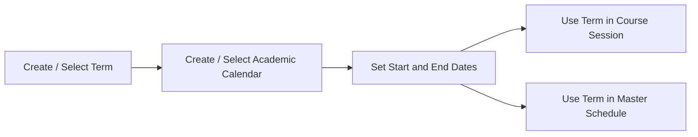

**Links**

- Terms: https://appslure.app/admin/program-management/terms
- Academic Calendars: https://appslure.app/admin/program-management/calendars

**Verify:** Session dates fit the selected term and the correct term is used when terms overlap.

---

## 7. Course Management — Course, Session and Instructor

**Course list:** https://appslure.app/admin/course-management/courses  
**Create course:** https://appslure.app/admin/course-management/courses/new

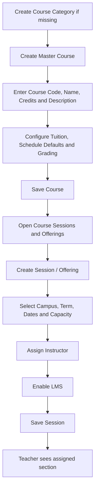

**Supporting links**

- Categories: https://appslure.app/admin/course-management/categories
- Groups: https://appslure.app/admin/course-management/groups
- Types: https://appslure.app/admin/course-management/types
- Grading Schemes: https://appslure.app/admin/course-management/grading
- Textbooks: https://appslure.app/admin/course-management/textbooks

**Important:** A master course by itself is not teachable. A dated session/offering with an instructor and LMS enabled is required.

---

## 8. Program Management — Complete Program Flow

**Faculties and Programs:** https://appslure.app/admin/program-management/faculties  
**Master Scheduling:** https://appslure.app/admin/program-management/scheduling

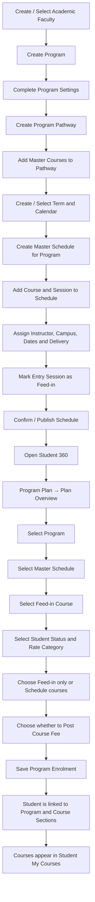

### Program creation and assignment steps

1. Open **Faculties & Programs**.
2. Create/select the academic faculty.
3. Create the program and complete Program Settings.
4. Open **Program Pathway**, create a pathway, and add the required master courses.
5. Open **Master Scheduling** and create a Master Schedule for that program.
6. Add the pathway courses as dated sessions.
7. Assign the instructor, campus, term, dates, capacity and delivery method.
8. Mark the first valid entry session as **This is a feed-in course session**.
9. Save/confirm the schedule.
10. Open **Student Management → Browse All Students → select student**.
11. Open **Program Plan → Plan Overview**.
12. Select Program, Schedule, Feed-in Course, Student Status and Rate Category.
13. Choose either **Feed-in course only** or **Feed-in course and the schedule's later courses**.
14. Choose whether course fees should be posted.
15. Select **Save Program Enrolment**.

### Where does Feed-in Course come from?

`Selected Program → Selected Master Schedule → Course Session marked Feed-in → Feed-in Course dropdown`

The dropdown will be empty if the course exists only in Course Management but has not been added to the selected Master Schedule and marked as a feed-in session.

### Status warning

The **Student Status** selected while saving Program Enrolment becomes the student's current Student Management status. Selecting **Graduated**, for example, moves the student from **Approved Application** to the **Graduated** queue.

---

## 9. Student Assignment — Direct Course vs Program

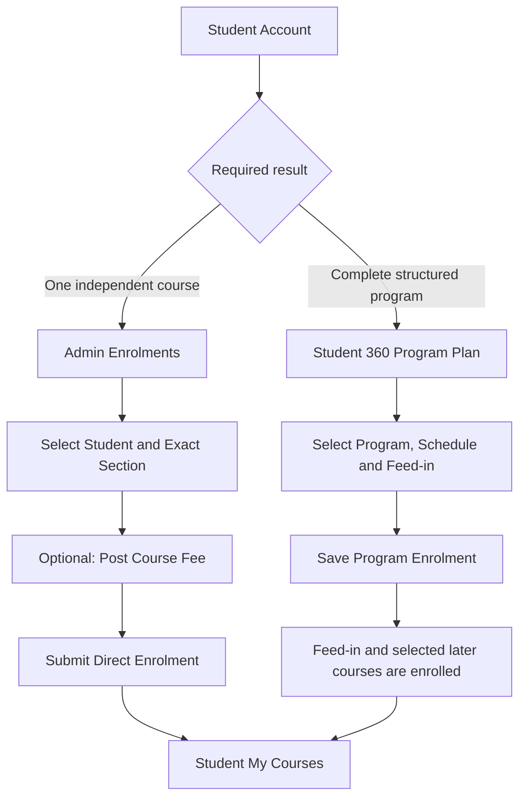

**Direct enrolment:** https://appslure.app/admin/enrolments

Use direct enrolment for a single course. Use Program Plan when the student must follow a formal pathway/master schedule.

---

## 10. Instructor Teaching Flow

**Instructor portal:** https://appslure.app/instructor

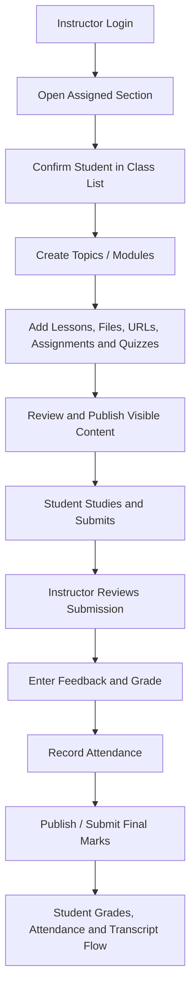

**Main links**

- Sections: https://appslure.app/instructor/sections
- Roster: https://appslure.app/instructor/roster
- Attendance: https://appslure.app/instructor/attendance
- Assessments: https://appslure.app/instructor/assessments
- Submissions: https://appslure.app/instructor/submissions
- Gradebook: https://appslure.app/instructor/gradebook
- Announcements: https://appslure.app/instructor/announcements

---

## 11. Student Learning Flow

**Student portal:** https://appslure.app/student

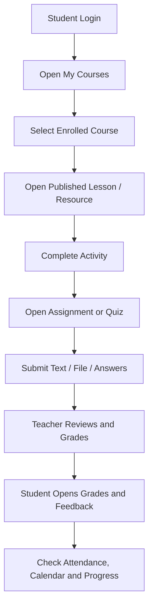

**Main links**

- My Courses: https://appslure.app/student/courses
- Assignments: https://appslure.app/student/assignments
- Assessments: https://appslure.app/student/assessments
- Grades: https://appslure.app/student/grades
- Attendance: https://appslure.app/student/attendance
- Calendar: https://appslure.app/student/calendar
- Fees: https://appslure.app/student/fees
- Documents: https://appslure.app/student/documents
- Messages: https://appslure.app/student/messages

---

## 12. AI Draft — Single Lesson Flow

**Link:** https://appslure.app/instructor/ai-draft

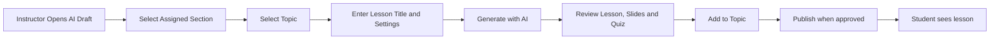

AI Draft creates one reviewed lesson in the selected section. It does not create a complete program or automatically publish to unrelated sections.

---

## 13. AI Course Builder — Full Self-Paced Course

**Admin entry:** https://appslure.app/admin/self-paced/content

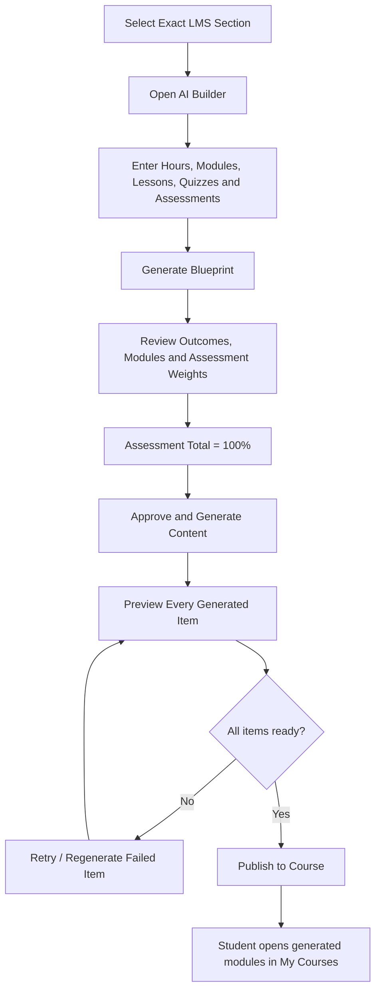

Always enter through the exact section card. Do not copy another section's generated URL or section ID.

---

## 14. Public Self-Paced Catalogue Flow

**Admin catalogue:** https://appslure.app/admin/self-paced/catalogue  
**Public catalogue:** https://appslure.app/selfpaced

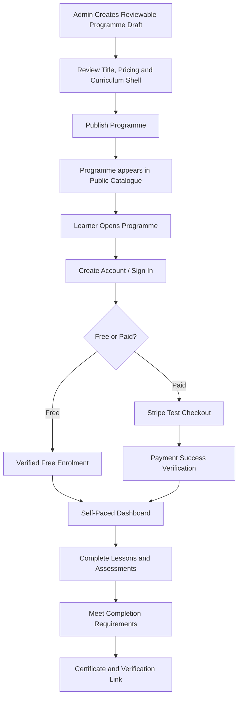

**Important:** Public Self-Paced is separate from campus `/apply`. Public self-paced registration leads to free/paid enrolment, not an admissions application.

---

## 15. Financial Management Flow

**Select student:** https://appslure.app/admin/financial/student

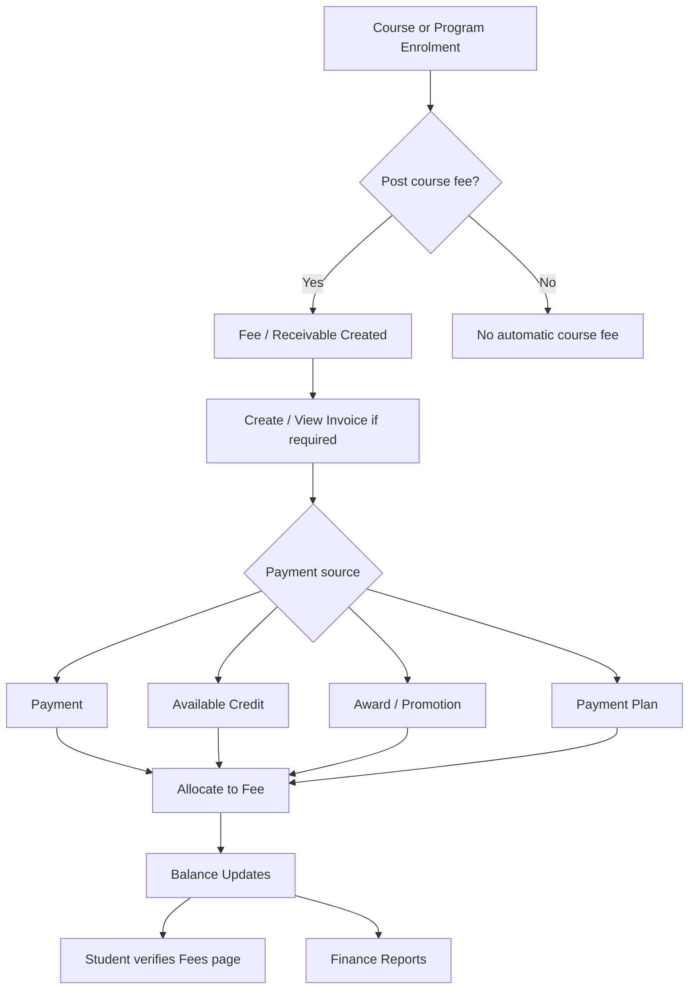

**Operational links**

- Transactions: https://appslure.app/admin/financial/transactions
- Fees: https://appslure.app/admin/financial/fees
- Invoices: https://appslure.app/admin/financial/invoices
- Credits & Disbursements: https://appslure.app/admin/financial/disbursements
- Awards: https://appslure.app/admin/financial/awards
- Adjustments: https://appslure.app/admin/financial/adjustments
- Payment Plans: https://appslure.app/admin/financial/payment-plans
- Unallocated Funds: https://appslure.app/admin/financial/unallocated-funds
- Alerts: https://appslure.app/admin/financial/alerts

**Message meaning:** “The fee was added, but the student has no available credit to pay it” means the fee was successfully posted but remains unpaid. Do not add the fee again; record or allocate a payment/credit.

---

## 16. Workshop Flow

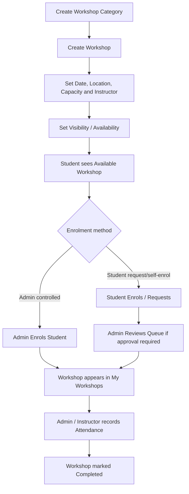

**Links**

- Manage Workshops: https://appslure.app/admin/workshops/manage
- Create Workshop: https://appslure.app/admin/workshops/manage/new
- Create Category: https://appslure.app/admin/workshops/manage/categories/new
- Enrol Student: https://appslure.app/admin/workshops/enrol
- Enrolment Queue: https://appslure.app/admin/workshops/enrolments
- Attendance: https://appslure.app/admin/workshops/attendance
- Student Workshops: https://appslure.app/student/workshops

---

## 17. Student Requests Flow

**Student entry:** https://appslure.app/student/f/st-16-services

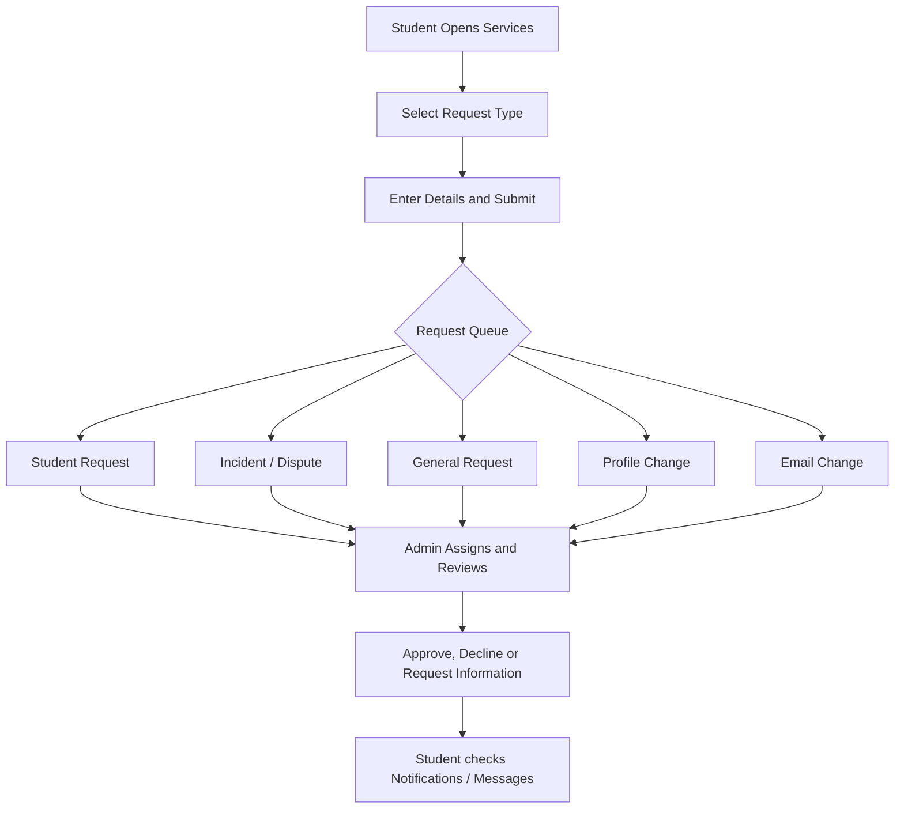

**Admin queues**

- Student Requests: https://appslure.app/admin/requests?f.type=Student+Requests
- Incidents / Disputes: https://appslure.app/admin/requests?f.type=Incidents+%2F+Disputes
- General Requests: https://appslure.app/admin/requests?f.type=General+Requests
- Profile Changes: https://appslure.app/admin/requests?f.type=Profile+Changes
- Email Changes: https://appslure.app/admin/requests?f.type=E-mail+Changes

Verify the actual destination queue after submission. A profile-originated email update may enter Profile Changes rather than the dedicated Email Changes queue.

---

## 18. Public Apply and Admissions Flow

**Apply:** https://appslure.app/apply  
**Admissions Applications:** https://appslure.app/admin/ops/admissions/applications

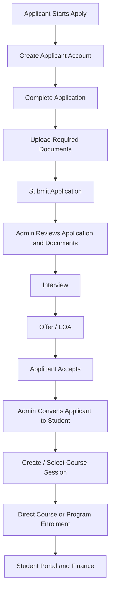

`/apply` belongs to Admissions. It is not the public Self-Paced registration flow.

---

## 19. Student Management Flow

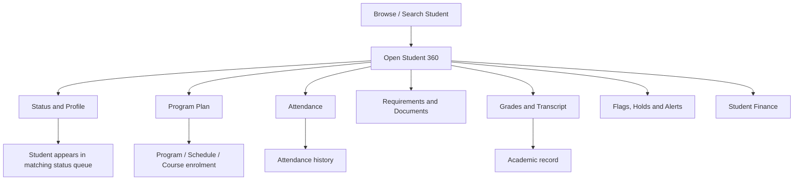

**Links**

- Browse All Students: https://appslure.app/admin/student-management/browse
- Student Search: https://appslure.app/admin/student-search
- New Inquiry: https://appslure.app/admin/student-management/browse?f.status=New+Inquiry

The selected student's generated ID controls the Student 360 URL, so open the profile from Browse/Search rather than inventing a URL.

---

## 20. Reporting Flow

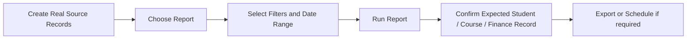

**Links**

- Run Report: https://appslure.app/admin/reporting/run
- Templates: https://appslure.app/admin/reporting/templates
- Scheduled Reports: https://appslure.app/admin/reporting/scheduled

Route availability or sample rows are not proof of a successful report. Confirm that a real record created earlier in the test appears with the correct filters.

---

## 21. System Configuration Flow

```mermaid
flowchart LR
    A[Institution Policy] --> B[Configure Reference Data]
    B --> C[Statuses / Access Levels / Grading / Finance Settings]
    C --> D[Reference Values appear in operational dropdowns]
    D --> E[Operational modules save records using those values]
```

Use System Configuration only when a required status, access level, template, payment method or reference value is missing. Avoid creating duplicate reference records.

---

## 22. Owner Acceptance Test — Serial Order

Use one unique test prefix across every module, for example `OWNER-UAT-20261008`.

| # | Action | Expected connected result |
|---:|---|---|
| 1 | Admin signs in | Admin dashboard opens |
| 2 | Confirm location, term and calendar | Values are available in scheduling forms |
| 3 | Create teacher | Teacher can log in |
| 4 | Create student | Student can log in without a program |
| 5 | Create master course | Course appears in Course Management |
| 6 | Create session and assign teacher | Teacher sees the assigned section |
| 7 | Create program and pathway | Pathway contains the master course |
| 8 | Create Master Schedule | Program schedule exists |
| 9 | Add course session and mark Feed-in | Feed-in becomes available in Student Program Plan |
| 10 | Save Student Program Enrolment | Program/schedule are shown in Student 360 |
| 11 | Verify Student My Courses | Enrolled course is visible |
| 12 | Teacher publishes a lesson | Student can open the same lesson |
| 13 | Teacher publishes an assignment | Student can submit it |
| 14 | Teacher grades submission | Student sees grade and feedback |
| 15 | Teacher records attendance | Student attendance updates |
| 16 | Post one fee | Student balance shows the fee once |
| 17 | Apply payment/credit | Outstanding balance updates correctly |
| 18 | Create and enrol in workshop | Workshop appears for student |
| 19 | Submit each request type | Correct admin queue receives it |
| 20 | Run report | Same test record appears in report |
| 21 | Test AI Draft | Lesson is added only to selected section/topic |
| 22 | Test AI Course Builder | Reviewed content publishes to exact self-paced section |
| 23 | Test public Self-Paced | Verified enrolment leads to learner dashboard, not `/apply` |
| 24 | Logout and test role isolation | Each account sees only its permitted portal and data |

## Completion Rule

The portal flow passes only when the same record can be followed across modules:

`Admin setup → Teacher assignment → Student enrolment → Published learning → Student activity → Teacher grade/attendance → Student finance → Admin report`

A visible page, sample table or successful URL alone is not an end-to-end pass. The action must save successfully and the next role/module must receive the same record.
